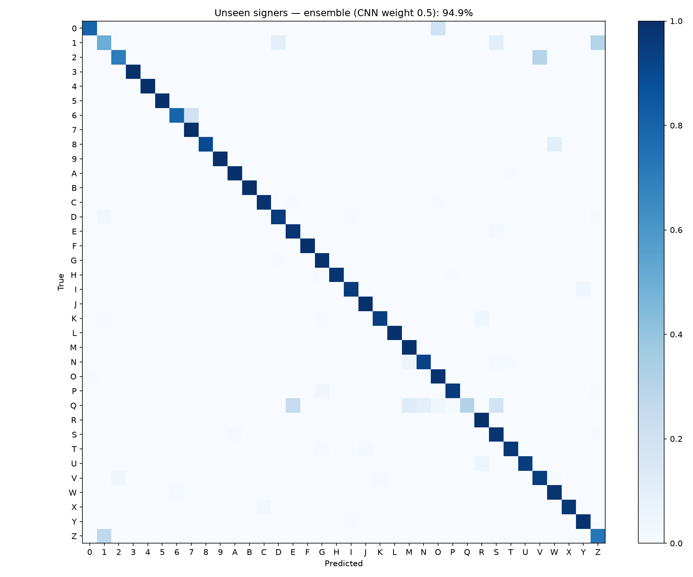

# 🤟 SignWave AI — Reconnaissance de la Langue des Signes Américaine (ASL)

[](https://www.python.org/)
[](https://pytorch.org/)
[](https://ai.google.dev/edge/mediapipe/solutions/vision/hand_landmarker)
[](https://opencv.org/)

> **Projet de Vision par Ordinateur & Deep Learning**
> **Module :** Computer Vision (INFO-CV401)

SignWave AI lit l'alphabet de la langue des signes américaine (ASL) à la webcam ou sur une image et
l'écrit sous forme de texte. Le système reconnaît les **36 configurations statiques** de la main
(lettres A–Z et chiffres 0–9) et les épelle lettre par lettre en direct.

**Précision : 94,9 %** sur des signeurs jamais vus pendant l'entraînement.

---

## 🏛 Pipeline

```text
 Webcam / image
      │
      ▼
 MediaPipe Hand Landmarker ── 21 points 3D de la main
      │
      ├──► Points normalisés (poignet = origine, taille de la paume = 1)
      │    + 210 distances entre articulations ──► MLP ────────────┐
      │                                                           ├─► moyenne des probabilités ─► lettre
      └──► Recadrage 224 × 224 centré sur la main ──► CNN ────────┘   (ConvNeXt-Tiny, transfer learning ImageNet)
                                                                              │
                                                                              ▼
                                                  Lissage temporel + maintien 0,8 s ─► texte épelé
                                                                              │
                                                                              ▼
                                                  Modèle de grammaire (gloses ASL ─► phrase anglaise)
```

- **Modèle de points (MLP)** : invariant au fond, à la couleur de peau et à l'éclairage.
- **Modèle image (CNN)** : voit ce que les points ratent (contact des doigts, position du pouce).
- **Ensemble** : moyenne simple des deux, avec un poids de 0,5 fixé à l'avance (non réglé sur le test).

---

## 📊 Résultats

Le découpage est fait **par signeur**. Les personnes du test (Surrey n°5, le signeur « office »,
la main Massey n°5) n'ont jamais été vues à l'entraînement.

| Modèle | Test (signeurs inconnus) |
|---|---|
| Random Forest (baseline classique) | 88,8 % |
| MLP sur les points | 90,1 % |
| CNN ConvNeXt-Tiny | 93,8 % |
| **Ensemble MLP + CNN** | **94,9 %** |



**Erreurs restantes.** Ce sont surtout des signes identiques sur une image fixe : 0/O, 2/V, 1/Z
et 6/7. Le mode *lettres* / *chiffres* de la démo élimine ces confusions. J et Z demandent un
mouvement.

**Remarque.** 83 % du test provient d'un même signeur (Surrey 5). Les chiffres les plus
réalistes sont donc ceux du signeur « office » (88,8 %) et de la main Massey (89,3 %).

---

## 🚀 Lancer la démo webcam

```bash
git clone https://github.com/yassine-dev2004/computer-vision.git
cd computer-vision
python -m venv .venv
.venv\Scripts\activate                     # Linux/Mac : source .venv/bin/activate

# PyTorch avec GPU NVIDIA (sinon : pip install torch torchvision)
pip install torch torchvision --index-url https://download.pytorch.org/whl/cu128
pip install -r requirements.txt

python -m recognition.live                 # ou double-clic sur SignWaveAI.bat (Windows)
```

Les modèles entraînés sont inclus dans `checkpoints/recognition/` et `models/` : aucun
entraînement n'est nécessaire.

| Touche | Action |
|---|---|
| *tenir un signe 0,8 s* | tape la lettre |
| *baisser la main* | fin du mot (espace automatique) |
| `M` | mode lettres / chiffres / tout |
| `ESPACE` / `RETOUR` / `C` | espace / effacer / tout effacer |
| `ENTRÉE` | envoie les mots au modèle de grammaire |
| `Q` / `ÉCHAP` | quitter |

**Options :**
- `--no-cnn` : modèle de points seul, assez rapide pour un PC sans GPU.
- `--camera 1` : utilise une autre webcam.
- `--hold 0.6` : réduit le temps de maintien nécessaire pour taper une lettre.

**Sur une image :**

```bash
python -m recognition.predict photo.jpg
```

---

## 🗂 Dataset

Le dataset `combine_asl` regroupe **141 689 photos en 36 classes**, fusionnées à partir de quatre
sources publiques :

- [Kaggle ASL Alphabet](https://www.kaggle.com/datasets/grassknoted/asl-alphabet) : un signeur.
- ASL Fingerspelling de l'Université de Surrey : 5 signeurs.
- Un signeur photographié dans un bureau.
- Les chiffres de l'Université Massey : 5 mains.

Le dataset n'est pas versionné (3 Go). Pour réentraîner, placez-le dans un dossier contenant un
sous-dossier par classe, puis lancez :

```bash
python -m recognition.extract --dataset CHEMIN/combine_asl    # points + recadrages, ~20 min
python -m recognition.train_landmarks                         # MLP + Random Forest, ~5 min
python -m recognition.train_cnn --arch convnext_tiny          # CNN, ~45 min (RTX 4070 Laptop)
python -m recognition.evaluate                                # tableau + matrice de confusion
```

MediaPipe détecte une main dans 91,1 % des images. La phase d'extraction prend environ 20 min
sur 28 processus.

**Choix d'entraînement :**
- Un échantillonnage équilibré par classe **et** par signeur, pour que le signeur unique de
  Kaggle (la moitié des données) ne domine pas.
- Des augmentations : miroir (signeurs gauchers), rotation ±15°, couleurs.
- Le CNN est entraîné en bf16 avec AdamW et un cosine schedule. On garde la meilleure époque sur
  la validation.

---

## ✍️ Modèle de grammaire (`grammar/`)

L'ASL ne suit pas l'ordre des mots de l'anglais : le temps vient d'abord, le sujet avant le
commentaire, et il n'y a ni articles ni verbe « être ». Un petit Transformer encodeur-décodeur,
entraîné depuis zéro sur ASLG-PC12, traduit une suite de gloses en phrase anglaise. Les mots
épelés (`fs-NOM`) sont recopiés tels quels via des emplacements réservés.

```bash
python -m grammar.train                                    # télécharge ASLG-PC12 (Hugging Face)
python -m grammar.translate YESTERDAY fs-JOHN STORE GO     # -> Yesterday John went to the store.
```

*État : code prêt et testé sur des données jouets. L'entraînement complet reste à lancer. Une
fois `checkpoints/grammar/model.pt` présent, la démo webcam l'utilise automatiquement (touche
ENTRÉE).*

---

## 📂 Structure du dépôt

```text
computer-vision/
├── recognition/                 # reconnaissance des signes statiques
│   ├── extract.py               #   MediaPipe sur tout le dataset -> points + recadrages
│   ├── features.py              #   normalisation des points, distances, MLP
│   ├── train_landmarks.py       #   entraînement du MLP (+ baseline Random Forest)
│   ├── train_cnn.py             #   transfer learning ConvNeXt-Tiny / EfficientNet / MobileNet
│   ├── evaluate.py              #   comparaison et matrice de confusion
│   ├── predict.py               #   SignRecognizer : pipeline complet sur une image
│   └── live.py                  #   démo webcam
├── grammar/                     # gloses ASL -> anglais (Transformer)
├── checkpoints/recognition/     # modèles entraînés + métriques
├── models/hand_landmarker.task  # modèle MediaPipe
├── docs/                        # notes du projet (Word)
├── SignWaveAI.bat               # lanceur Windows de la démo
├── requirements.txt
│
├── demo/                        # premier prototype (SignNet, scripts step1-4, dashboard)
├── DATASET/                     # 900 images du premier prototype
└── presentation_signwave_ai.html
```

Le premier prototype (`demo/`) utilise l'ancienne API `mp.solutions`. Celle-ci n'existe plus dans
les versions récentes de MediaPipe (≥ 0.10.30, Python 3.13). Le nouveau pipeline utilise l'API
Tasks.

---

## 👥 Auteurs

- **Yassine Mezghanni** ([yassine-dev2004](https://github.com/yassine-dev2004))
- **Ryan Trabelsi** ([RyanTrabelsi](https://github.com/RyanTrabelsi))
